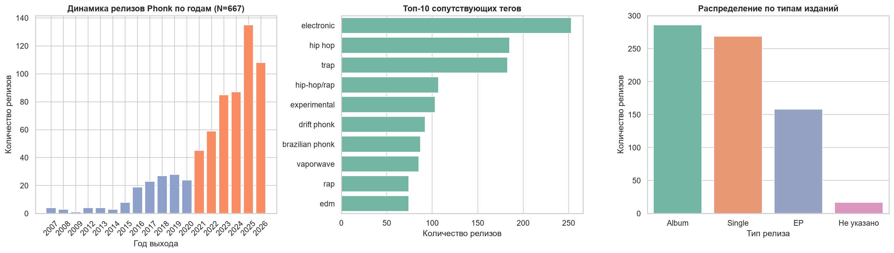

# От андеграунда к вирусным чартам: как музыкальный каталог MusicBrainz отражает эволюцию жанра Phonk

## 1. Вопрос

За последнее десятилетие фонк прошёл путь от нишевого интернет-поджанра, вдохновлённого кассетным мемфис-рэпом и эстетикой вейпорвейва, до глобального мейнстрима в TikTok, Spotify и автомобильной дрифт-культуре.

**Исследовательский вопрос:** Как менялось количество релизов с тегом `phonk` в базе MusicBrainz с 2007 по 2026 год и какие поджанры, типы изданий и форматы носителей преобладают на раннем этапе и после выхода жанра в мейнстрим?

На этот вопрос можно ответить данными MusicBrainz API, так как карточка каждого релиза содержит дату выхода (`date`), пользовательские теги (`tags`), тип издания (`primary-type`), формат носителя (`format`) и страну релиза (`country`). В работе для полного массива релизов по тегу `phonk` (730 уникальных записей) подсчитываются хронологическая динамика по годам, частоты сопутствующих жанровых тегов, распределение типов релизов (`Album`, `Single`, `EP`) и соотношение цифровых и физических носителей.

---

## 2. Источник

* **Почему выбран этот API:** MusicBrainz — крупнейшая открытая музыкальная энциклопедия с документированным REST API, не требующая получения API-ключа, поддерживающая поиск по тегам с логическими операторами и пагинацию (`limit` / `offset`) в формате JSON.
* **Кто создаёт данные:** База наполняется и редактируется сообществом волонтёров-энтузиастов по принципу вики-проекта.
* **Что считается одной записью:** В эндпоинте `/ws/2/release` одной записью является конкретное издание музыкального релиза (альбом, сингл или EP) с уникальным идентификатором MBID.
* **Какие части предметной области источник описывает плохо:**
  * *Стриминговый и соцсетевой андеграунд:* ранний SoundCloud-фонк и вирусные треки из TikTok/Яндекс Музыки выходят без физических носителей, поэтому в каталог попадает лишь та часть сцены, которую вручную занесли активные участники сообщества.
  * *География интернет-релизов:* при цифровой дистрибуции по всему миру невозможно выделить одну страну выпуска, из-за чего массово проставляется технический код `XW` (Worldwide), скрывающий реальную страну происхождения исполнителя.
  * *Нестрогость пользовательских тегов:* система тегов не разделяет строгие музыкальные поджанры и общие пользовательские метки (например, `electronic` или `experimental`).

---

## 3. Сбор

Код сбора данных находится в тетрадке `hw1/hw1.ipynb`, итоговый датасет сохранён в `hw1/data.csv` (кодировка UTF-8).

В скрипте реализованы:
* функция запроса `fetch_releases_page` с осмысленным заголовком `User-Agent` (с указанием названия проекта и контакта), параметром `timeout=30`, заголовком `Connection: close`, паузой `time.sleep(1.5)` (соблюдение ограничения MusicBrainz — не более 1 запроса в секунду) и обработкой временных сбоев (`503 Service Unavailable` и разрывов SSL-соединения с повторными попытками);
* двухэтапная пагинация по параметрам `limit=50` и `offset` с ограничением числа запросов (`max_requests_per_query=10`): поскольку поисковый движок MusicBrainz ограничивает глубину выдачи на одном запросе (ошибка `400` при `offset >= 500`), общий запрос `tag:phonk` разделён на два непересекающихся временных среза — `tag:phonk AND NOT date:[2023 TO 2026]` (ранний этап и релизы без даты) и `tag:phonk AND date:[2023 TO 2026]` (период мейнстрима);
* преобразование вложенного JSON-ответа в плоскую таблицу `pandas.DataFrame` с удалением дубликатов по `id` и сохранением в CSV.

---

## 4. Описание данных

* **Дата сбора:** 26.11.2026
* **Эндпоинт и параметры запроса:** `GET https://musicbrainz.org/ws/2/release`, параметры `fmt=json`, `limit=50`, два поисковых запроса: `tag:phonk AND NOT date:[2023 TO 2026]` и `tag:phonk AND date:[2023 TO 2026]`.
* **Число записей:** 730 уникальных релизов (практически полный массив каталога по тегу `phonk` на момент сбора).

### Описание столбцов `data.csv`

| Столбец | Тип | Описание |
|---|---|---|
| `id` | string | Уникальный идентификатор релиза в MusicBrainz (MBID) |
| `title` | string | Название релиза |
| `artist` | string | Имя основного исполнителя (первый элемент из `artist-credit`) |
| `date` | string | Дата выхода релиза в формате `YYYY-MM-DD` или `YYYY` |
| `year` | float/int | Год выхода релиза, извлечённый из первых 4 символов `date` |
| `country` | string | Двухбуквенный код страны релиза по ISO 3166-1 (или `XW` для мирового цифрового релиза) |
| `primary_type` | string | Основной тип группы релизов (`Album`, `Single`, `EP`) |
| `format` | string | Формат носителя первого медиа-объекта (`Digital Media`, `CD-R`, `CD`, `Cassette`, `12" Vinyl`, `Vinyl`) |
| `status` | string | Статус издания (`Official`, `Bootleg`, `Promotion`) |
| `label` | string | Название первого указанного лейбла из `label-info` |
| `track_count` | int | Общее количество треков в релизе |
| `tags` | string | Список пользовательских тегов релиза через запятую |

### Заполненность ключевых полей и влияние пропусков

* **Без пропусков (0.0%):** `id`, `title`, `artist`, `tags`.
* **Минимальные пропуски:** `track_count` (0.1%), `format` (0.4%), `primary_type` (2.3%), `status` (2.9%).
* **Существенные пропуски:** поле `country` отсутствует у **8.5%** записей (62 из 730), поля `date` и `year` — у **8.6%** записей (63 из 730), поле `label` — у **36.3%** записей (265 из 730).

Пропуски в `year` (8.6%) означают, что при построении динамики по годам из хронологического анализа выпадают 63 релиза (преимущественно любительские цифровые издания без оформленной даты). Пропуски в `country` (8.5%) в сочетании с кодом `XW` (69.5%) не позволяют достоверно определить национальную принадлежность большинства релизов по карточке издания.

---

## 5. Предварительный ответ

Распределение основных характеристик в собранном наборе данных (N = 730):

| Категория | Значение | Число релизов | Доля (%) |
|---|---|---|---|
| **Корневые теги** *(из `tags`)* | `electronic` / `hip hop` / `trap` | 253 / 185 / 183 | 34.7% / 25.3% / 25.1% |
| | `experimental` / `vaporwave` | 103 / 85 | 14.1% / 11.6% |
| **Вирусные поджанры** | `drift phonk` | 92 | 12.6% |
| | `brazilian phonk` | 87 | 11.9% |
| | `phonk house` | 73 | 10.0% |
| **Тип релиза** | `Album` | 286 | 39.2% |
| | `Single` | 269 | 36.8% |
| | `EP` | 158 | 21.6% |
| **Формат носителя** | `Digital Media` | 707 | 96.8% |
| | Физические носители (`CD-R`, `CD`, `Cassette`, `Vinyl`) | 20 | 2.7% |
| **Этапы развития** | 2007–2020 гг. (андеграундный этап) | 148 | 20.3% |
| | 2021–2026 гг. (выход в мейнстрим) | 519 | 71.1% |
| **География релиза** | `XW` (Worldwide) | 507 | 69.5% |
| | `ID` (Индонезия) | 87 | 11.9% |
| | `US` / `DE` (США / Германия) | 19 / 16 | 2.6% / 2.2% |

*(Визуализация основных распределений приведена в `hw1/hw1.ipynb`, ячейка 5 — `phonk_analysis.png`.)*

**Интерпретация:**
Собранные данные чётко разделяют историю жанра на два этапа: с 2007 по 2020 год в базе фиксировалось в среднем около 12 релизов в год (суммарно 148 записей, или 20.3%), тогда как после 2021 года начался взрывной рост — 519 релизов (71.1%) с пиком в 2025 году (135 релизов). В полной выборке хорошо видна двойственная природа жанра: с одной стороны, сохраняется связь с ранними корнями (`hip hop` — 25.3%, `trap` — 25.1%, `vaporwave` — 11.6%) и высокая доля полноформатных альбомов (`Album` — 39.2%, почти наравне с синглами — 36.8%), с другой — выделяется пласт поздних вирусных направлений (`drift phonk` — 12.6%, `brazilian phonk` — 11.9%, `phonk house` — 10.0%) при абсолютном доминировании цифры (`Digital Media` — 96.8%). Вместе с тем структура данных отражает особенности самого каталога MusicBrainz: у 161 релиза (22.1%) тег `phonk` отсутствует в списке тегов конкретного издания, так как поиск API учитывает также теги группы релизов или исполнителя. Показателен и географический перекос: помимо технического кода `XW` (69.5%), на втором месте оказалась Индонезия (`ID` — 87 релизов против 19 у США), что объясняется высокой активностью отдельных локальных редакторов в открытой базе, а не реальным мировым лидерством страны в индустрии фонка.

---

## 6. Ограничения и следующий шаг

1. **Смещение волонтёрского каталога:** MusicBrainz отражает активность редакторов-энтузиастов, а не реальную прослушиваемость треков (отсюда аномальная доля Индонезии в географии релизов и неполнота раннего SoundCloud-архива). Для объективной оценки выхода фонка в мейнстрим на следующем шаге стоит сопоставить динамику с внешними источниками — например, со статистикой просмотров статей об артистах и поджанрах в **Wikimedia Pageviews API**.
2. **Условность географии релиза:** код `XW` (Worldwide, 69.5%) не позволяет определить страну происхождения музыканта. Чтобы восстановить реальную географию сцены (США, СНГ, Бразилия, Европа), нужно обогатить таблицу через **Wikidata API** или эндпоинт `/ws/2/artist` в MusicBrainz, забрав поле `area` (страна происхождения самого исполнителя).
3. **Разделение эпох в анализе тегов:** в текущей таблице частоты тегов посчитаны по всему массиву; на следующем шаге стоит сравнить частотность тегов отдельно для среза 2007–2020 гг. и среза 2021–2026 гг., чтобы количественно доказать вытеснение классического `vaporwave`/`trap`-звучания поджанрами `drift` и `brazilian phonk`.